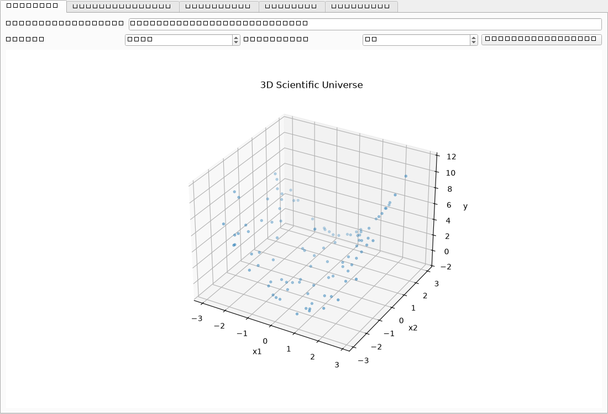
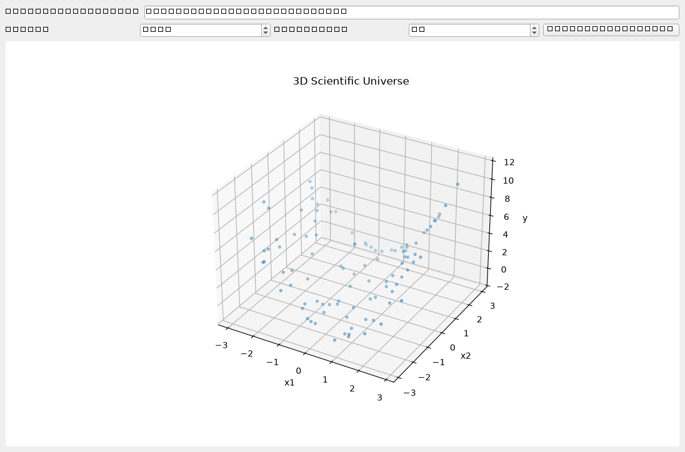
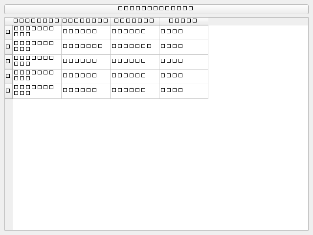
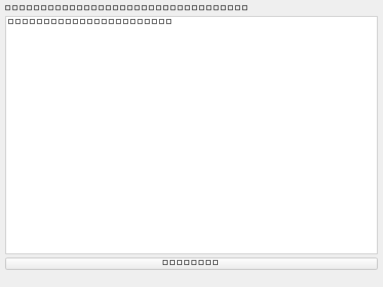
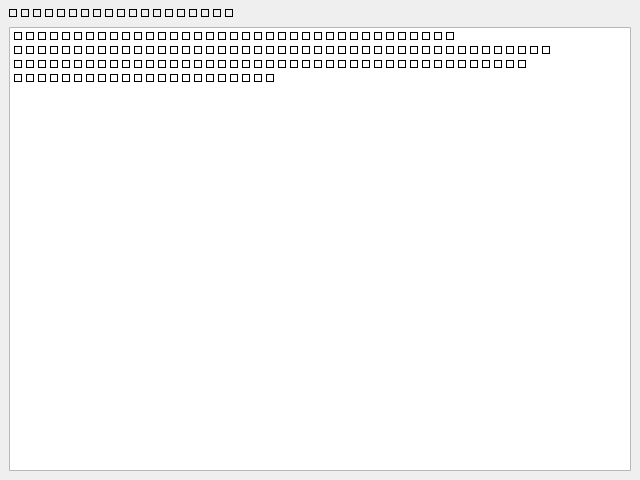

# PARADIGM ZERO

> Scientific research platform investigating whether AI agents can independently discover unknown mathematical and physical laws inside controlled simulated universes.

**Important:** All discoveries are about **simulated universes only**. Nothing here claims discoveries about real-world physics.

## Overview

PARADIGM ZERO generates configurable universes with hidden ground-truth equations, lets researchers run experiments with instruments and noisy observations, generates competing mathematical hypotheses, applies symbolic regression, and automatically tests hypotheses on unseen data. Discoveries are benchmarked against ground truth.

## Features

- **Configurable universes** — hidden equations, variable ranges, seeds, sample counts
- **Nonlinear systems** — polynomials, trig, products, interactions
- **Hidden variables** — latent factors not exposed in observations
- **Noisy observations** — instrument precision/bias, output noise
- **Competing explanations** — multiple candidate hypotheses scored side-by-side
- **Unseen test data** — train/test split with generalization gap
- **Symbolic regression** — feature-library + least-squares constant fitting
- **Benchmarks** — equation recovery, prediction accuracy (R²), generalization, reproducibility

## Desktop Application (PySide6)

- **Universe tab** — configure hidden equation/noise/samples; interactive 3D scatter of the simulated universe
- **Equation Editor** — validate candidate equations (SymPy syntax)
- **Hypotheses tab** — run discovery; table of candidates with train/test R²
- **Timeline tab** — experiment log
- **Dashboard tab** — benchmark metrics vs ground truth








## Quick Start

```powershell
pip install -r requirements.txt
$env:PYTHONPATH="src"
python -m paradigm_zero
```

## Tests

```powershell
pytest -q
```

## Windows EXE

Build with:

```powershell
python -m PyInstaller --clean --noconfirm --windowed --name ParadigmZero --paths src src/paradigm_zero/__main__.py --distpath dist --workpath build
```

Output: `dist/ParadigmZero/ParadigmZero.exe` (verified to launch).

## Project Layout

```
src/paradigm_zero/
  core/        universe, instruments, hypothesis, symbolic_regression, testing, benchmark
  ui/          PySide6 main window (3D universe, editor, explorer, timeline, dashboard)
tests/         pytest suite
docs/          scientific methodology
screenshots/   genuine application screenshots
```

## Scope & Limitations

- Symbolic regression uses a fixed feature library (linear, quadratic, sin/cos, products) with linear constant fitting — effective for equations in that span, not arbitrary deep expressions.
- Hidden variables are deterministic functions of observed variables in the default configuration.
- Treat all results as simulated-universe science.

## License

MIT — see [LICENSE](LICENSE).
